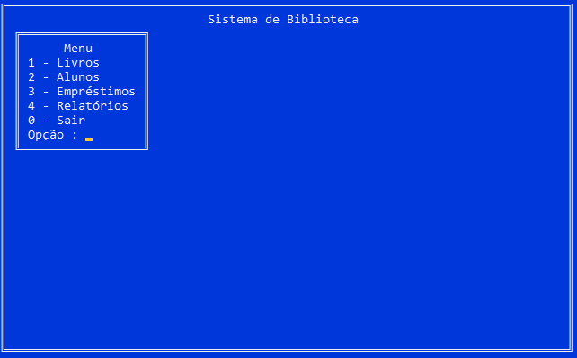
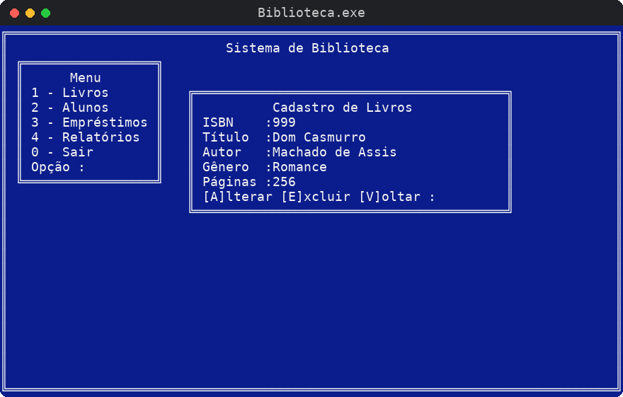
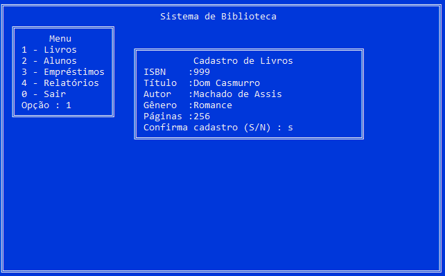
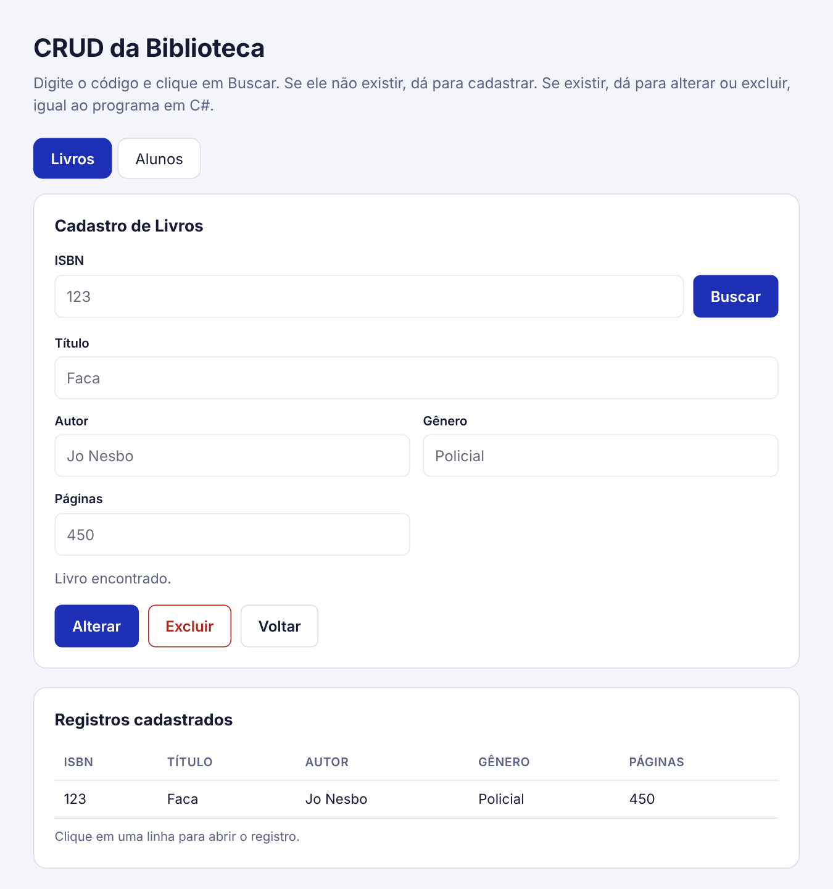

# Sistema de Biblioteca

Cadastro de livros e alunos feito em C# para console, como trabalho da faculdade de Engenharia de Software. Usei o padrão MVC e guardei os dados em listas na memória.



## O que ele faz

Livros e alunos têm um CRUD completo. Você digita o código (ISBN no livro, matrícula no aluno) e o programa decide o que mostrar.

- Se o código não existe, ele pergunta se você quer cadastrar.
- Se já existe, mostra os dados e deixa você alterar, excluir ou voltar.
- Alterar e excluir sempre pedem confirmação. Se você desistir, nada muda.




## Como rodar

Precisa do Visual Studio 2022 com o desenvolvimento para desktop com .NET.

1. Clone o repositório.
2. Abra o arquivo `Biblioteca/Biblioteca.sln`.
3. Aperte F5.

Já vem um livro com ISBN 123 e um aluno com matrícula 123 para você testar logo de cara.

## Organização do código

```
Biblioteca/
  Program.cs           menu principal
  Tela.cs              moldura, cores e menu
  LivroModel.cs        dados do livro
  LivroView.cs         tela do livro
  LivroController.cs   CRUD do livro
  AlunoModel.cs        dados do aluno
  AlunoView.cs         tela do aluno
  AlunoController.cs   CRUD do aluno
```

O Model guarda os dados, a View desenha e lê o teclado, e o Controller decide o que fazer.

## Documentação

Depois de pronto, escrevi a documentação como num projeto de verdade. Cada parte fica em uma pasta, em PDF.

- [Requisitos](documentacao/01-requisitos/Requisitos.pdf) com requisitos funcionais, não funcionais e regras de negócio
- [Casos de uso](documentacao/02-casos-de-uso/Casos-de-Uso.pdf) com o diagrama e a descrição de cada caso
- [Fluxogramas](documentacao/03-fluxogramas/Fluxogramas.pdf) do menu e das operações do CRUD
- [Modelagem](documentacao/04-modelagem/Modelagem.pdf) com diagrama de classes e de sequência
- [Plano de testes](documentacao/05-testes/Plano-de-Testes.pdf) com os casos testados

## Interface web

Em `interface-web/index.html` tem uma versão simples em HTML, CSS e JavaScript, só para ver o CRUD com campos e botões. Basta abrir o arquivo no navegador. Ela é separada do C# e os dados somem ao recarregar a página.



## O que falta

- Empréstimos e Relatórios aparecem no menu, mas ainda não foram feitos.
- Os dados ainda não são salvos. Quero trocar a lista por arquivo ou banco de dados.
- Falta validar email e telefone.
